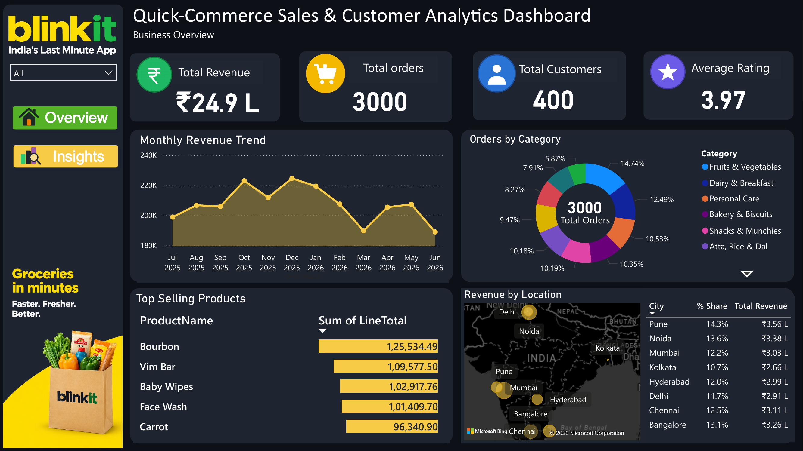
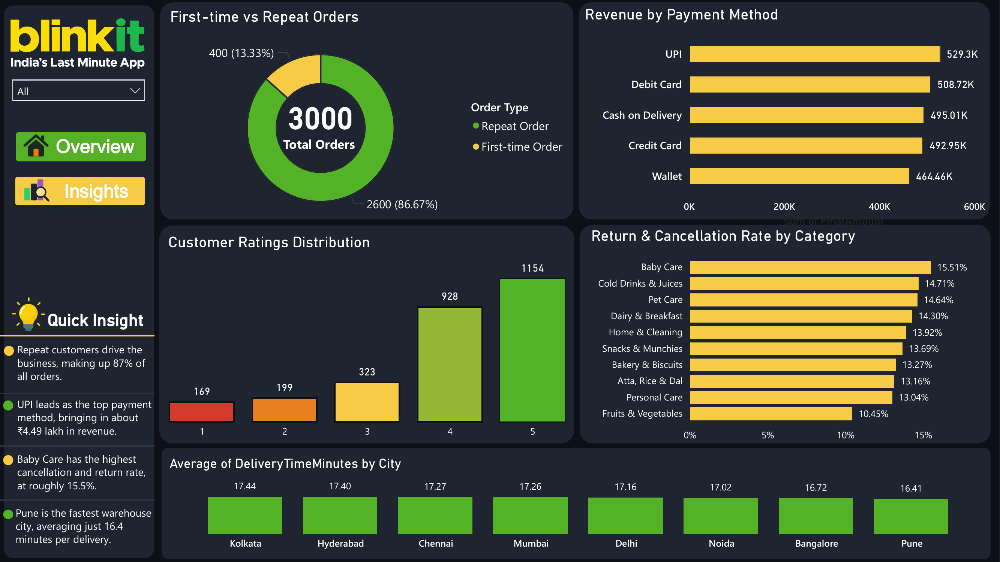

Blinkit E-Commerce Customer & Sales Performance Analysis

End-to-end data analytics project simulating a quick-commerce business, from raw data to an interactive Power BI dashboard.

Overview
This project analyzes 3,000 orders from 400 customers across 49 products and 8 warehouse cities. SQL was used for querying, Python for data preparation, and Power BI for building the interactive dashboard.

Tools Used
- SQL (MySQL), for data cleaning, joins, and aggregate queries
- Python (Pandas), for data preparation
- Power BI (DAX, dashboarding), for visualization

Dataset
The dataset has 5 tables:
- products: 49 items across 10 categories
- customers: 400 customers
- warehouses: 8 cities
- orders: 3,000 orders from Jul 2025 to Jun 2026
- order_items: 8,958 line records

Dashboard Pages

Overview Page
Total revenue, orders, customers and average rating KPIs, a monthly revenue trend, orders by category, top selling products, and revenue by location.

Insights Page
First-time vs repeat orders, revenue by payment method, customer ratings distribution, return and cancellation rate by category, and average delivery time by warehouse city.

Key Insights
- Repeat customers drive the business, making up 87% of all orders.
- UPI leads as the top payment method, bringing in about ₹4.49 lakh in revenue.
- Baby Care has the highest cancellation and return rate, at roughly 15.5%, while Fruits & Vegetables has the lowest at 10.45%.
- Pune is the fastest warehouse city, averaging just 16.4 minutes per delivery, while Kolkata is the slowest at 17.44 minutes.
- Fruits & Vegetables accounts for the largest share of orders, at 14.74%.

Connect
Email: bishtprashant98@gmail.com
LinkedIn: linkedin.com/in/prashant-bisht-551172396

